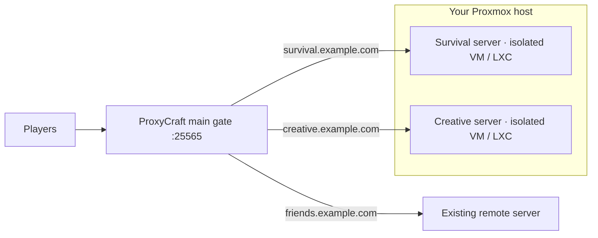

<div align="center">


# ProxyCraft

**The Minecraft proxy that just works.**

Isolated servers. One main gate. A UI to connect them.

[The idea](#one-gate-many-worlds) · [Get running](#get-running) · [Features](#the-control-room) · [API](docs/API.md) · [Roadmap](docs/ROADMAP.md)

</div>

---

## One gate. Many worlds.

I wanted isolated Minecraft servers on my Proxmox host, with one main gate that could easily proxy players to the right server. ProxyCraft is the tool I wanted to manage that setup through a simple UI.

**Bring your own Minecraft servers.** ProxyCraft does not create, host, or run Minecraft servers or worlds. Its job is to make proxying your existing servers easy to configure and manage, whether they live in separate VMs, LXC containers, on your LAN, or somewhere else entirely.

Point your player-facing domains at one gate, choose a destination for each domain, and let players connect using the usual **25565** port.

> **Development status:** Java Edition routing, TCP forwarding, isolated route edits, TCP reachability, SQLite storage, the dashboard/API, authenticator 2FA, optional public welcome pages, and live domain events are implemented. Richer Minecraft status details remain planned.



Proxmox inspired the project; it is not a requirement. Your existing servers can live wherever the gate can reach them. The initial protocol target is **Minecraft Java Edition**.

## The control room

| Feature | What you get today |
| --- | --- |
| **Configured proxies** | Search, add, edit, and delete routes. Desktop table, mobile cards, numeric live connection counts, and click-to-copy domains. |
| **Live routing** | Save a route and use it immediately. Editing resets only that route's connections. |
| **Connection history** | See the latest 20 player login attempts per proxy. Deleting a proxy also deletes its history. |
| **Live connections** | Open the monitor/activity icon to see current named TCP sessions, refreshed every 2 seconds and kept only in memory. |
| **Reachability** | Active / Unreachable reflects a TCP check of the destination port, repeated every 10 seconds. |
| **Sensible ports** | Listener and backend settings default to **25565**. The dashboard has its own web port. |
| **One API** | The UI and external tools use the same JSON management endpoints. |
| **API reference and key** | View endpoint inputs, outputs, and examples from App Settings; generate one API key for external clients. |
| **Optional sign-in** | Start without login; enable authentication in App Settings when you want it. |
| **Two-factor authentication** | Add an authenticator app and one-use recovery codes to your main account. |
| **Public welcome page** | Set a custom welcome message and optionally show click-to-copy domain names. |
| **Live domain events** | API-key-authenticated SignalR notifications when domains are added, removed, or renamed. |
| **Automatic storage** | EF Core creates the SQLite schema on launch. No manual database setup. |
| **Your kind of dashboard** | Clean Light, simple Dark, or full Rainbow with neon gradients and mouse-connected particles. |

Route settings live in SQLite; connections and health live in memory. An unreachable backend is retried automatically, without disabling the route or changing your saved settings.

## Get running

ProxyCraft can be installed directly on **Debian 13**. App testing so far is limited to a **Debian 13 LXC** and **Docker**; other native Linux distributions have not been tested. The installer targets Debian 13 on amd64/arm64 with systemd.

### Debian 13 installer

Run this one-liner as root inside your Debian 13 VM/LXC (or use `sudo bash` instead of `bash`):

```bash
curl -fsSL https://raw.githubusercontent.com/DragoQC/ProxyCraft/main/install.sh | bash
```

The installer downloads the latest source directly from [DragoQC/ProxyCraft](https://github.com/DragoQC/ProxyCraft). No checkout or repository argument is needed. On a minimal Debian image without curl, first run `apt-get update && apt-get install -y curl ca-certificates`.

The installer installs the .NET 10 SDK when needed, builds the app, and starts the `proxycraft` systemd service as a dedicated user. It keeps app data in `/var/lib/proxycraft` and configuration in `/etc/proxycraft/proxycraft.env`. Open **http://SERVER_IP:8080**; Minecraft defaults to **TCP 25565**. Use `--port 8081` to choose another dashboard port, or `--ref TAG_OR_COMMIT` to select a remote revision. Pass options with `| bash -s -- --port 8081`. Rerun the installer to update while preserving data; old releases are retained and a failed startup restores the previous release.

```bash
systemctl status proxycraft
journalctl -u proxycraft -f
```

### Docker

From the project root, build the image and start the supplied Compose service:

```bash
docker compose up -d --build
```

Open **http://SERVER_IP:8080**. The image runs as a non-root user, publishes dashboard **8080** and Minecraft **25565**, and keeps SQLite, settings, and cookie-protection keys in the `proxycraft-data` volume. Keep that volume when updating.

To build and run the image without Compose:

```bash
docker build -t proxycraft:local .
docker run -d --name proxycraft --restart unless-stopped \
  -p 8080:8080 -p 25565:25565 \
  -v proxycraft-data:/var/lib/proxycraft \
  proxycraft:local
```

Changing the Minecraft listener port in the UI also requires updating the container port mapping. Use reachable backend IPs/hostnames; `localhost` inside Docker refers to the ProxyCraft container.

The installer and Docker serve the dashboard over HTTP for LAN use. Put it behind your HTTPS reverse proxy when needed. See [installation details](docs/INSTALLATION.md) for paths, configuration, updates, and verification scope.

### Development

With the **.NET 10 SDK** installed, run these commands from the project root:

```bash
dotnet restore
dotnet run --launch-profile http
```

Open **http://localhost:5180**.

The app creates its local database and settings on first launch. No account, schema command, Node.js runtime, or Minecraft server installation is needed to start the dashboard.

- **Home:** configured listener port, route count, and live CPU/RAM/disk cards with capacity and percentage in use.
- **Configured proxies:** search on the left, **+** on the right, click-to-copy domains, backend status, numeric live connection counts, and live/history/pen/trash buttons. Rows become cards on mobile with labeled destinations and larger touch targets. The monitor/activity icon shows current connections; history shows who tried to connect, the requested domain, and the time. Deleting removes the saved route, its history, and only its players' connections.
- **Proxy Settings:** configure the Minecraft listener port.
- **App Settings:** two masonry-style columns on desktop, one on mobile; configure sign-in, generate/regenerate the API key, and open the API reference.

For local HTTPS, trust the ASP.NET Core development certificate as appropriate for your OS, then run `dotnet run --launch-profile https` and open **https://localhost:7180**. Manual production runs enable HTTPS redirection and HSTS by default; the supplied deployments set `Http__RedirectToHttps=false` for their HTTP listener.

### Connect your servers

1. Point each player-facing domain's DNS A/AAAA records to the ProxyCraft machine. DNS changes are managed outside this app.
2. Allow/forward TCP **25565** to that machine and keep your existing Minecraft servers running on their own reachable IPs/ports.
3. Add a route such as `survival.example.com` → `192.168.1.10:25565` in **Configured proxies**.
4. Connect in Minecraft Java Edition using `survival.example.com`.

Saving a changed domain or destination takes effect immediately. Players on that route are disconnected and can reconnect using the new domain; players on other routes keep their connections. Failed validation or a duplicate domain leaves the running route alone. Restarting the app reloads saved routes automatically.

The history button shows the latest **20 login attempts per proxy**, newest first, with live refresh. Names come from the client's initial login packet; they do not prove authentication or a successful join. Server-list pings are excluded. Attempts are recorded even when the backend is unavailable. History survives restarts and keeps the original requested domain after edits; deleting the proxy permanently removes its events.

The **monitor/activity button** shows currently open forwarding sessions for that proxy, with the supplied player name, domain, and connection time. It refreshes every 2 seconds while open. Live state stays in memory and clears when a session closes or the app restarts; saved history stays in SQLite. Separate sessions can share a player name, and the live list has no 20-entry history cap. A session appears after the backend connection opens, while pending logins, status pings, and failed backends are excluded. This is TCP connection state, not confirmation of Minecraft authentication; a silent network failure remains visible until TCP detects it.

Both connection dialogs scroll their lists while keeping the title, count, and Close button visible. Refreshes preserve the visible entry while you read. The local [100-connection capacity check](docs/CAPACITY.md) exercises real forwarding traffic, API polling, history retention, and disconnect cleanup; browser checks cover 100 live entries and 20 attempts at desktop and mobile sizes. Capacity still depends on your host, network traffic, and backend servers.

Each destination host/port pair is unique: `192.168.120.40:25565` and `192.168.120.40:25566` can coexist, but the exact same destination cannot be assigned to two routes. Both adding and editing enforce this through the shared API.

Route domains must contain a meaningful dot, such as `play.example.com`; single-label names are not accepted. The destination field shows a small advisory for IPv4 addresses ending in `.1` or `.255`. These hints do not prevent saving: `.1` is often a router address, and `.255` is a broadcast address on a `/24` subnet; the actual role depends on the network.

**Active** means the backend's TCP port accepted a connection from ProxyCraft, not that a full Minecraft login was verified. Checks run every 10 seconds with a 2-second timeout; the list refreshes every 5 seconds. This is a transparent Java Edition TCP relay: backend authentication/encryption remain with the existing Minecraft server. Bedrock/UDP, legacy pre-1.7 handshakes, player-IP forwarding protocols, and in-game server switching are outside the current implementation.

## Lock the gate when you want

A fresh setup works without login. To enable authentication:

1. Open **App Settings → Enable authentication**.
2. Enter **one username or one email address**, plus a password of **12–128 characters**.
3. Save. You are sent to the login page to sign in with that account.

Enabling sign-in protects both the dashboard and management API. Passwords are hashed with ASP.NET Core's password hasher. A signed-in user can turn authentication off again in App Settings. This is controlled in the app; installation flags are not required.

In **App Settings → API access**, generate the app's single API key. Copy it immediately: only a SHA-256 hash and display prefix are stored, and the complete key is shown once. Regenerating replaces the same database row and immediately invalidates the previous key.

Once configured, external API requests send `X-API-Key: pc_...` and do not need cookies or a CSRF token. A valid key grants full management access, including when dashboard login is enabled. The UI keeps using its session and CSRF token. When login is disabled, the dashboard remains open to anyone who can reach it; an API key does not make an open dashboard private.

Open **App Settings → Open API reference** to see each endpoint's inputs, validation rules, response codes, and example JSON in a simple page that follows your theme. It is built in C#/Razor using the existing controller and DTO metadata. The [API reference](docs/API.md) also documents the header, endpoints, and browser/session behavior.

In **App Settings → Two-factor authentication**, confirm your password, add the displayed time-based secret to an authenticator app, and confirm a six-digit code. Save the eight recovery codes before signing in again. Two-factor setup is optional and uses nullable fields on the existing user. See [authentication and public visibility](docs/AUTHENTICATION.md) for setup, recovery, and storage details.

Enable **Public dashboard** to show anonymous visitors a welcome page while keeping management behind sign-in. Its message editor starts with **Welcome to ProxyCraft** and supports up to 500 plain-text characters. Domain visibility can be checked only while public access is enabled; turning access off clears it. Visitors can click a domain to copy it. Both visibility options default off; backend addresses, players, history, and resource metrics stay private. The admin **Dashboard** link previews the welcome page, and navigation shows icons on every screen with labels on desktop.

Integrations can connect to **`/api/v1/hubs/domains`** with `X-API-Key` and listen for **`DomainAdded`** and **`DomainRemoved`**. Notifications follow saved UI/API changes; renaming emits removal then addition. Read the [domain events guide](docs/DOMAIN_EVENTS.md) for payloads, a C# client example, and reconnect behavior.

## Pick your atmosphere

Use the theme picker in the header, including on the sign-in page:

- **Light:** the clean white dashboard.
- **Dark:** the same simple layout after dark.
- **Rainbow:** neon borders, smoothly animated colors, an aurora/grid background, and a constellation that connects to your cursor.

Your choice is remembered in this browser. On mobile, the header shows the logo and theme icons without their text labels. Rainbow effects run automatically whenever the theme is selected; there is no effects switch. Reduced-motion preferences are respected, and hidden tabs pause their effects. Theme preferences stay local to your browser and do not change server settings.

## Storage that sets itself up

| File | Purpose |
| --- | --- |
| `App_Data/proxycraft.db` | SQLite database with `users`, `proxies`, the single-row `api_keys` table, and `connection_events`. |
| `App_Data/settings.json` | Authentication mode, listener port, public visibility, and welcome message. |
| `<data-directory>/keys/` | Cookie-protection keys for installer/Docker deployments; keep with backups. |

All database models inherit `BaseModel`: `created_at`, `modified_at`, and `is_active`. Creation/modification timestamps are maintained in UTC. The data directory is excluded from version control and can be changed with `Storage:Directory` or the `Storage__Directory` environment variable.

**Want a fresh database for testing?** Stop the app, delete `proxycraft.db` and any accompanying `proxycraft.db-wal` / `proxycraft.db-shm` files, then restart. The app recreates the schema automatically, clears users/routes, and resets the saved authentication flag so you can set up a new main account. Repeat as often as you need.

Deleting just the database preserves other values in `settings.json` and also clears the API key and connection history. To reset settings too, remove the local `App_Data` directory while the app is stopped. Ordinary restarts preserve your data. On older installations, the initializer creates only the approved missing `api_keys` and `connection_events` tables and nullable 2FA fields on `users`. It preserves existing accounts, routes, and history. Other schema work requires separate approval; no manual migration command is needed.

## Under the hood

**ASP.NET Core MVC / .NET 10** · **EF Core SQLite 10.0.12** · **Tailwind CSS 4.3.3**

One application project, explicit C# types, Razor views, and a small JavaScript layer calling the management API. The project lives directly in this folder.

<details>
<summary><strong>Working on the UI</strong></summary>

Rebuild Tailwind styles through the .NET build tooling:

```bash
dotnet build -t:BuildCss --no-restore
```

This compiles CSS once and exits. On first use, the target downloads the official Tailwind **4.3.3** standalone executable for the SDK's host platform into `.tools/` and verifies its pinned SHA-256 checksum. Later calls reuse that local executable. A network connection is needed only for the first download. The roughly 80–112 MB compiler is a local development tool, excluded from source control and published output.

Edit `Views/`, `wwwroot/js/`, and `Styles/app.css`, then run the command again after changing utility classes. Include generated `wwwroot/app.css` with your changes. Normal `dotnet build` and `dotnet run` use that included stylesheet and do not download or run Tailwind. There is no Node.js/npm installation, `node_modules` directory, or separate CSS watcher in the project.

A CSS watcher is only a convenience that rebuilds styles automatically when source files change; it does not run the proxy or check Minecraft servers. This project uses explicit builds instead. If you want C# hot reload, `dotnet watch --launch-profile http` is optional and belongs to the .NET SDK.

Tailwind's standalone compiler is an external development executable, not a C# implementation of Tailwind. Browser interactions use plain JavaScript files served by MVC; they do not require Node.js. See the official [standalone compiler documentation](https://tailwindcss.com/docs/installation/tailwind-cli).

EF Core SQLite is the only direct NuGet package. ASP.NET Core handles MVC, API documentation metadata, cookies, password hashing, and the network proxy through the .NET shared framework. The API reference uses our own Razor views and adds no documentation package or browser library.

</details>

<details>
<summary><strong>Running the checks</strong></summary>

```bash
dotnet build --no-restore
dotnet format style --no-restore --verify-no-changes --diagnostics IDE0008
python3 tests/smoke_test.py
python3 tests/install_test.py
```

The integration checks launch the actual app with temporary storage and local TCP backends. They exercise byte-preserving forwarding, fragmented handshakes, route isolation, health recovery, listener changes, API/auth, persistence, and repeated database recreation. They delete only their own test database. Python 3 is needed for these checks, not to run ProxyCraft.

For deployment checks, the installer test simulates host commands without changing the machine. After `docker build -t proxycraft:local .`, run `python3 tests/docker_test.py` to exercise a disposable container, its published Minecraft port, and data/login persistence across recreation.

</details>

## Project map

[Architecture](docs/ARCHITECTURE.md) · [API reference](docs/API.md) · [Roadmap](docs/ROADMAP.md) · [Contributor rules](AGENTS.md) · [Tailwind UI guidance](skills/tailwind-ui/SKILL.md)

Next on the roadmap: richer Minecraft status details and further management controls.
