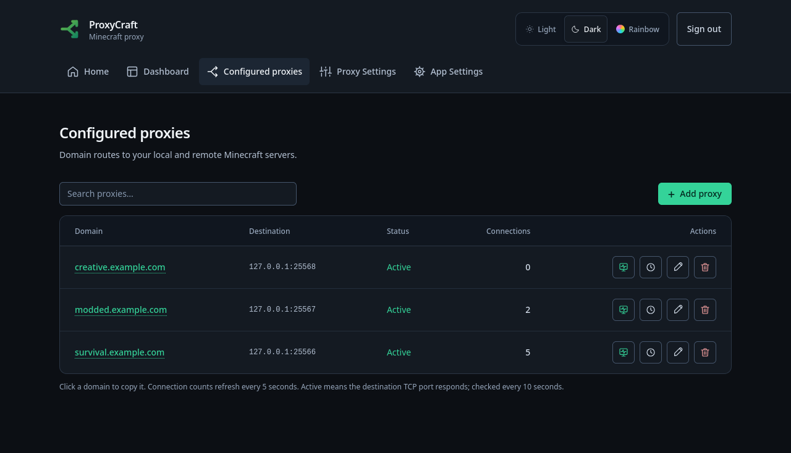
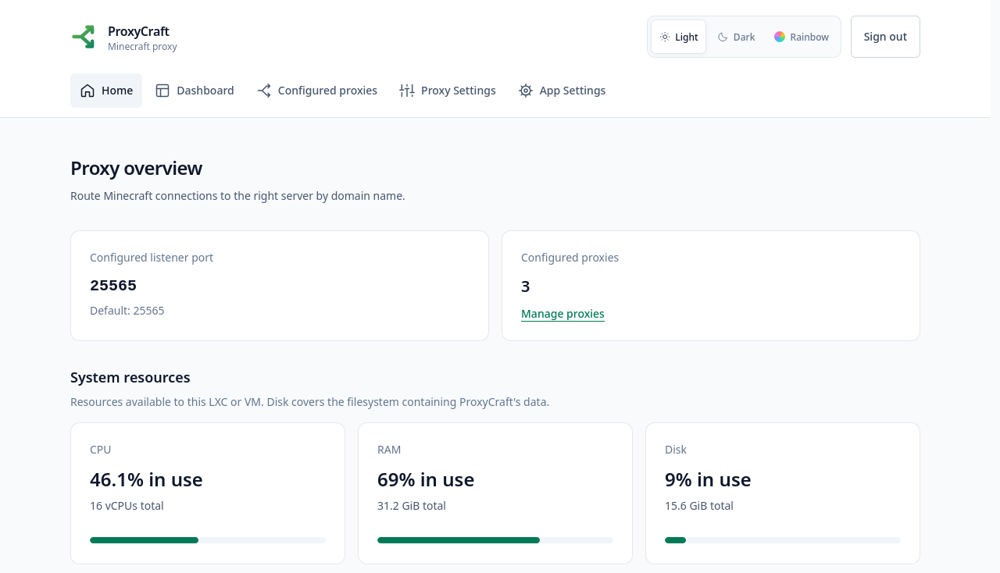
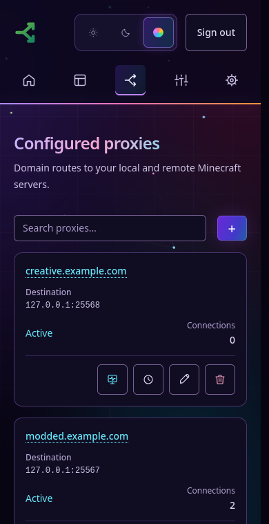

#  ProxyCraft

**The Minecraft proxy that just works.**

## Install

On **Debian 13**, run as root:

```bash
curl -fsSL https://raw.githubusercontent.com/DragoQC/ProxyCraft/main/install.sh | bash
```

Open **http://SERVER_IP:8080**. The app starts automatically, including after a reboot. Run the same command again to update; your routes, account, and settings stay saved.

**Requirements:** 1 vCPU · 1 GB RAM · 5 GB disk minimum (10 GB recommended). These resources are for the proxy; your Minecraft servers run separately.

The native installer supports Debian 13 with systemd on amd64/arm64. Tested in a **Debian 13 LXC** and **Docker**; other distributions have not been tested. [Installation details →](docs/INSTALLATION.md)

## One gate. Your servers.

ProxyCraft routes **Minecraft Java Edition** connections to your existing servers based on the domain a player joins. Players use the usual **25565** port; each destination can have its own IP and port.

```text
survival.example.com ──→ ProxyCraft :25565 ──→ 192.168.1.40:25565
modded.example.com   ──→ ProxyCraft :25565 ──→ 192.168.1.50:25566
```

I built it for my isolated Minecraft servers on Proxmox: one main gate, a simple UI, and an easy way to send players to the right server. Your servers can be on your LAN or elsewhere, as long as ProxyCraft can reach them. **It proxies existing servers; it does not host Minecraft servers or worlds.**

### Connect your servers

1. Point your domains at your public IP and forward **TCP 25565** to ProxyCraft.
2. In **Configured proxies**, add each domain and its destination IP/hostname and port.
3. Join using that domain in Minecraft. That's it.

## What you get

- **Simple management:** search, add, edit, delete, and click a domain to copy it. Works on desktop and mobile.
- **Immediate changes:** saving a route applies it right away, restarting only that route's connections.
- **Optional RCON forwarding:** enable it per route, choose a public port and backend RCON port (default **25575**), and connect using the same Minecraft domain. Each route needs its own public RCON port.
- **Connection visibility:** backend reachability, live connection counts and sessions, plus the latest **20 login attempts per proxy**.
- **Access your way:** optional sign-in and authenticator 2FA, API-key access for automation, and an optional public welcome page.
- **A useful dashboard:** CPU, RAM, and disk usage, with **Light**, **Dark**, and **Rainbow** themes.

The database sets itself up on first launch. No manual database setup or Node.js installation needed.

Fresh installs start without login. Enable sign-in in **App Settings** and generate an API key for remote management. Keep the dashboard/API on a trusted network or VPN, or protect it with an HTTPS reverse proxy. [Security notes →](docs/SECURITY.md)

## Screenshots

Example domains and demo connections; resource readings are from the capture machine.



<details>
<summary>Dashboard and mobile Rainbow view</summary>





</details>

## Prefer Docker?

```bash
git clone https://github.com/DragoQC/ProxyCraft.git
cd ProxyCraft
docker compose up -d --build
```

Uses the same **8080** dashboard and **25565** Minecraft ports. Publish any additional RCON ports you enable in your Docker port mappings and forward/restrict them on your router/firewall as needed. Keep the `proxycraft-data` volume when updating. [Docker details →](docs/INSTALLATION.md#docker)

---

[Installation & updates](docs/INSTALLATION.md) · [Authentication](docs/AUTHENTICATION.md) · [API](docs/API.md) · [Capacity](docs/CAPACITY.md) · [Architecture](docs/ARCHITECTURE.md) · [Roadmap](docs/ROADMAP.md)

**License:** [MIT](LICENSE). Free to use, modify, share, and sell; keep the copyright and license notice.
